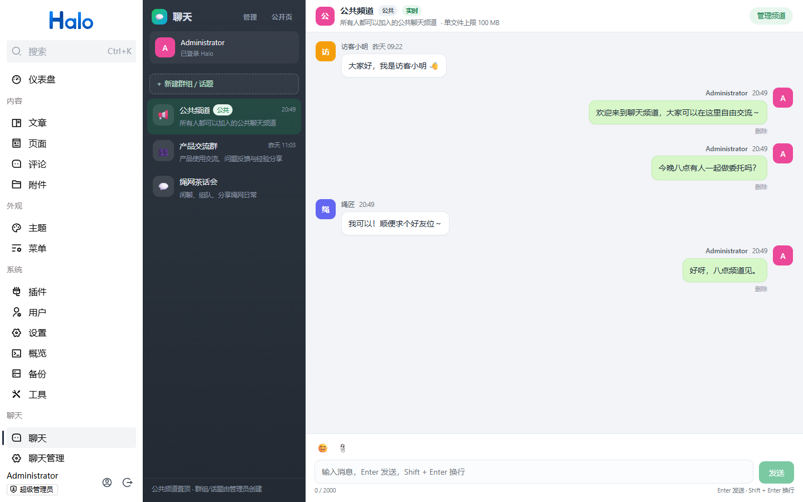
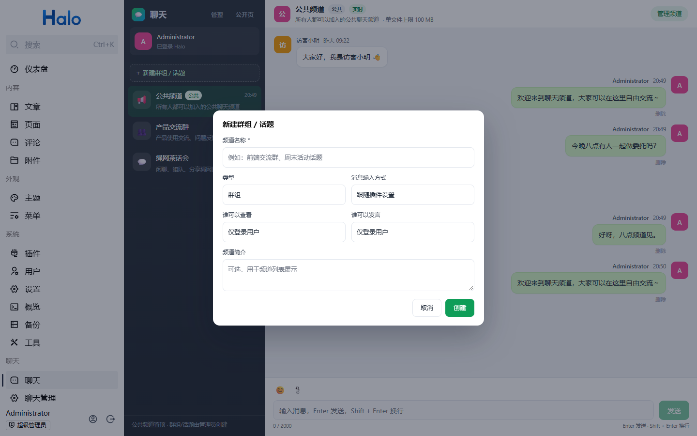
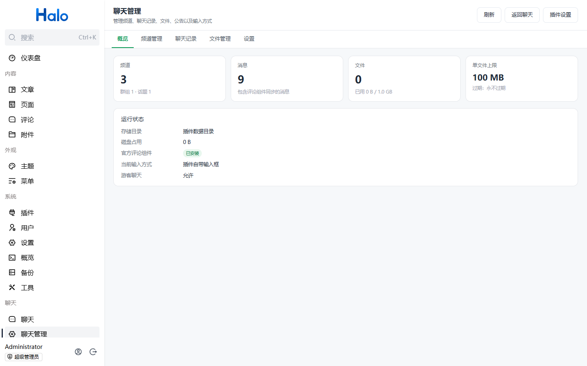
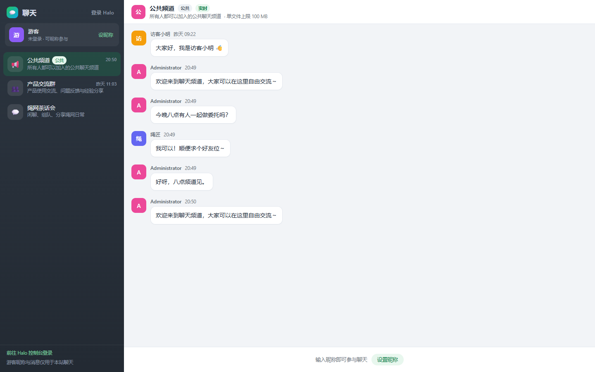
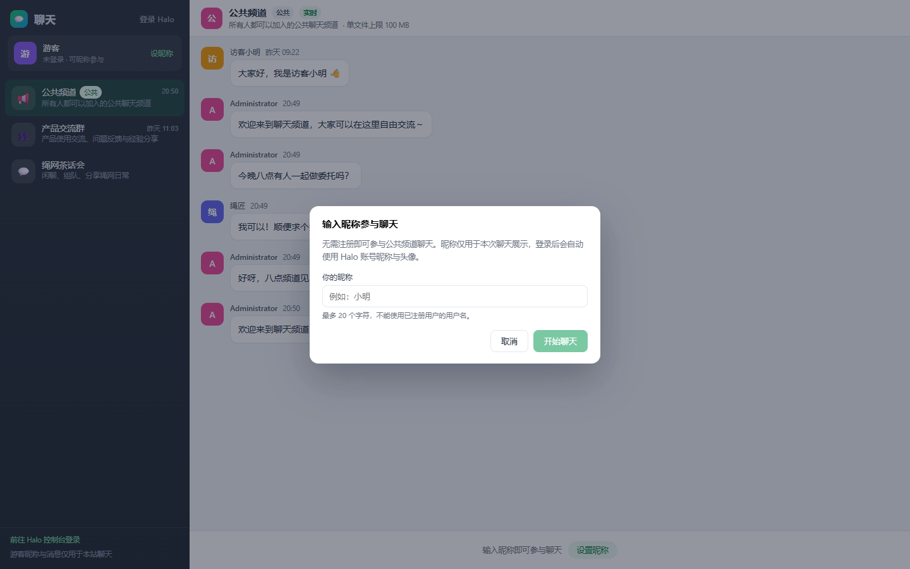

# halo-chat · 聊天频道（mine-dsa）

作者：mine-dsa · 项目主页：https://github.com/Mine-dsa/halo-chat · 个人主页：https://minedsa.cc

为 Halo 2.27+ 提供 QQ / 微信风格的站内聊天能力。插件同时提供 **Console 侧边栏聊天页、聊天管理页** 和 **前台独立聊天页**，支持公共频道、群组/话题、游客昵称发言、文件传输与配额、公告、管理员代发/编辑/删除消息，以及可切换的「Halo 官方评论组件」输入模式。

> 目标 Halo 版本：`2.27.x`（Java 21，Gradle 9.4，Node 22.12+，pnpm 10）

---

## 功能

- **公共频道**：安装后自动创建并置顶，所有人（含未登录游客）都可查看；游客输入昵称后即可发言。
- **群组 / 话题**：管理员可在聊天页侧边栏的 **「＋ 新建群组 / 话题」**，或管理页 **「频道管理 → 创建群组 / 话题」** 创建、编辑、解散；可设置可见范围与发言权限（所有人 / 登录用户 / 指定成员），并支持搜索 Halo 用户添加成员。
- **身份**：登录用户自动使用 Halo 账号昵称与头像；游客使用本次会话输入的昵称（服务端签名 Cookie，防伪造）。普通注册用户即使没有 Console 权限，也可以在前台公开聊天页以登录身份参与聊天。
- **实时消息**：基于 SSE 的实时推送，带断线重连与心跳；同源 Cookie 鉴权，无需额外配置。
- **文件**：登录用户可上传文件；管理员可设置单文件大小上限、插件总存储上限、文件过期天数，**均支持 0 = 无限制**；文件下载经过权限校验，私密频道文件不会暴露公开链接。
- **聊天管理页**（Console 侧边栏独立菜单）：频道管理、聊天记录查看/修改/删除/清空、文件管理、公告、以任意用户身份发送消息、存储用量统计。
- **输入方式可切换**（插件设置）：
  - `BUILTIN`：插件自带输入框；
  - `HALO_COMMENT`：嵌入 Halo 官方评论组件（`PluginCommentWidget`）的输入区，评论会实时同步为聊天消息；未安装评论组件或游客匿名评论未开启时自动回退。
- **权限**：基于 Halo RBAC 角色模板；匿名用户与登录用户通过聚合角色获得最小权限，聊天管理权限 `plugin:chat:manage` 可分配给自定义角色。

## 界面入口

| 入口 | 地址 | 说明 |
| --- | --- | --- |
| Console 聊天 | `/console/chat` | 侧边栏「聊天」菜单，拥有 Console 访问权限的用户/管理员使用 |
| Console 聊天管理 | `/console/chat/admin` | 侧边栏「聊天管理」菜单，需要 `plugin:chat:manage`（超级管理员默认拥有） |
| 前台公开聊天页 | `/plugins/halo-chat/` | 游客与普通登录用户可直接访问，自动识别 Halo 登录身份 |
| 插件设置 | `/console/plugins/halo-chat` | 文件限制、输入方式、限流、游客开关 |

> 侧边栏中的「聊天 / 聊天管理」位于插件菜单位置（安装插件较多时可能需要向下滚动侧边栏）。

### 创建群组 / 话题

有两种图形化入口，管理员任选其一：

1. **聊天页侧边栏**：频道列表上方的 **「＋ 新建群组 / 话题」** 按钮（仅管理员/聊天管理权限可见）；
2. **聊天管理页**：侧边栏「聊天管理」→「频道管理」→ **「创建群组 / 话题」**。

创建弹窗中可设置：

- 频道名称、简介；
- 类型：群组 / 话题；
- 消息输入方式：跟随插件设置 / 插件自带输入框 / Halo 评论组件；
- **谁可以查看**、**谁可以发言**：所有人（含游客）/ 仅登录用户 / 仅指定成员；
- 选择「仅指定成员」后可搜索 Halo 用户并添加成员。

创建成功后会自动选中新频道并展示在频道列表中。管理页的「编辑」可随时修改上述设置，「解散」会级联删除该频道的消息与文件。

### 界面预览

Console 聊天（侧边栏包含新建入口）：



新建群组 / 话题弹窗：



Console 聊天管理：



前台公开聊天页（游客昵称发言）：



游客昵称弹窗：



## 安装

1. 构建插件：

   ```bash
   # Linux / macOS
   ./gradlew clean build

   # Windows（本仓库提供的脚本会设置 JDK/证书环境）
   .\scripts\build.ps1
   ```

   产物：`build/libs/plugin-halo-chat-<version>.jar`。

2. 在 Halo Console 的「插件 → 安装」上传该 JAR，安装后启用。
3. 启用后会自动创建公共频道并注册角色模板，无需额外初始化。

也可以把 JAR 放进 `{halo.work-dir}/plugins/` 并调用插件安装/启用接口（本地开发脚本 `scripts/dev-halo.ps1` 已封装）。

## 开发

### 环境

- JDK 21
- Node.js ≥ 22.12、pnpm 10
- Halo 2.27.1 JAR（放在工作区 `halo主程序/halo-2.27.1.jar`）

Windows 本机环境（JDK 路径、HTTPS 证书信任、pnpm 存储目录）已经封装在 `scripts/env.ps1`：

```powershell
. .\scripts\env.ps1
```

- 构建：`.\scripts\build.ps1`
- 启动本地 Halo 并安装/更新插件：`.\scripts\dev-halo.ps1`
- 安装脚本默认 Halo 地址 `http://127.0.0.1:18090`，工作目录 `.dev/halo-workdir`，管理员 `admin / Admin@12345`（仅本地测试用）。

### 目录结构

```
src/main/java/cc/minedsa/halochat/
  ChatPlugin.java             插件生命周期（注册模型、公共频道、密钥、配额初始化）
  extension/                  自定义模型：ChatChannel / ChatMessage / ChatFile / ChatGuest
  endpoint/                   公共 API、管理 API、前台页面路由
  service/                    频道、消息、文件、游客、身份、SSE、清理任务
  comment/                    评论组件输入模式：CommentSubject + 评论→消息镜像
  config/                     插件设置读取
src/main/resources/
  plugin.yaml                 插件清单
  extensions/                 设置、角色模板、ReverseProxy、扩展点声明
  static/web/                 构建生成的前台页面与静态资源（通过 ReverseProxy 暴露）
ui/                           Vue 3 + Vite（Console UI + 前台独立 UI）
```

### 数据与存储

- 自定义模型：`chat.halo.run/v1alpha1` 下的 `ChatChannel`、`ChatMessage`、`ChatFile`、`ChatGuest`。
- 文件实体：`{halo.work-dir}/chat-data/files/`，元数据与配额在自定义模型中；文件不会以静态资源公开。
- 过期清理：插件每 10 分钟清理过期文件、临时文件与长期未活跃的游客会话。
- 备份：`chat-data` 位于 Halo 工作目录内，随工作目录一起备份。

## 设置项

| 分组 | 字段 | 默认 | 说明 |
| --- | --- | --- | --- |
| general | `guestEnabled` | true | 允许游客聊天 |
| general | `guestUploadEnabled` | false | 允许游客上传文件 |
| general | `guestNameMaxLength` | 20 | 游客昵称最大长度 |
| general | `messageMaxLength` | 2000 | 单条消息最大长度 |
| general | `guestRateLimit` / `userRateLimit` | 20 / 120 | 每分钟消息数，0 不限制 |
| files | `maxFileSizeMb` | 100 | 单文件上限（MB），0 不限制 |
| files | `maxTotalSizeMb` | 1024 | 总存储上限（MB），0 不限制 |
| files | `expireDays` | 0 | 文件过期天数，0 永不过期 |
| composer | `mode` | BUILTIN | `BUILTIN` 或 `HALO_COMMENT` |

频道维度还可以覆盖输入方式（跟随全局 / 自带输入 / 评论组件）。

## 权限模型

- `halo-chat-role-anonymous`（隐藏）：聚合到 `anonymous`，允许匿名调用公共聊天 API；具体频道可见性/发言权限由插件业务层校验。
- `halo-chat-role-authenticated`（隐藏）：聚合到 `authenticated`，所有登录用户可聊天。
- `halo-chat-role-manage`（可分配）：授予 `console.api.chat.halo.run` 管理 API 权限与 `plugin:chat:manage` UI 权限。超级管理员自动拥有全部权限。

## 已知限制

- SSE 事件总线、配额计数为单实例内存实现；多副本部署需要共享消息总线（当前未实现）。
- 评论组件输入模式依赖官方 `PluginCommentWidget`；评论组件未安装或游客匿名评论被站点关闭时，游客自动回退到插件自带输入框。
- 游客默认不能上传文件（可在设置中开启）。
- 管理端「以用户身份发送」会记录代发标记，消息显示「管理员代发」。
- Console 聊天页位于 Halo 管理后台，需要拥有 Console 访问权限的角色；普通注册用户无需 Console 权限，直接访问前台 `/plugins/halo-chat/` 即可，登录后会自动使用其 Halo 昵称与头像。

## 开发验证

```powershell
. .\scripts\env.ps1
.\scripts\build.ps1

# 启动本地 Halo（首次会自动安装并启用插件），-Reset 可得到干净实例
.\scripts\dev-halo.ps1 -Reset

# 对运行中的实例执行端到端冒烟检查
.\scripts\smoke-test.ps1
```

冒烟检查覆盖：公共频道初始化、匿名/游客身份、游客发言、管理员 API 鉴权、频道创建/解散、消息代发/编辑/删除、文件上传/下载/删除、设置读取与官方评论组件检测。

当前版本（1.0.0）已在 Halo 2.27.1 上完成以下验证：

- 干净工作目录首次安装、启用插件；
- Console 聊天/聊天管理页面与侧边栏菜单；
- **纯浏览器图形化操作**：登录 → 侧边栏进入聊天 → 新建群组/话题（聊天页按钮与管理页按钮）→ 设置可见/发言权限与成员 → 发送消息 → 上传/下载文件 → 公告 → 以用户身份发送 → 修改/删除/清空消息 → 删除文件 → 解散频道；
- 前台游客昵称发言、游客改昵称、游客上传按钮禁用、实时 SSE 跨浏览器推送；
- 官方评论组件输入区提交评论并同步为聊天消息，以及「改用聊天输入框」回退；
- 群组/话题权限、公告、代发消息、解散频道、删除消息与文件；
- 单文件上限（超限提示）、总存储配额、文件过期清理、游客上传限制；
- 普通登录用户（无 Console 权限）在前台页面自动识别身份并聊天，管理员可管理全部内容。

随后访问：

- `http://127.0.0.1:18090/console/chat`
- `http://127.0.0.1:18090/console/chat/admin`
- `http://127.0.0.1:18090/plugins/halo-chat/`

## License

GPL-3.0
